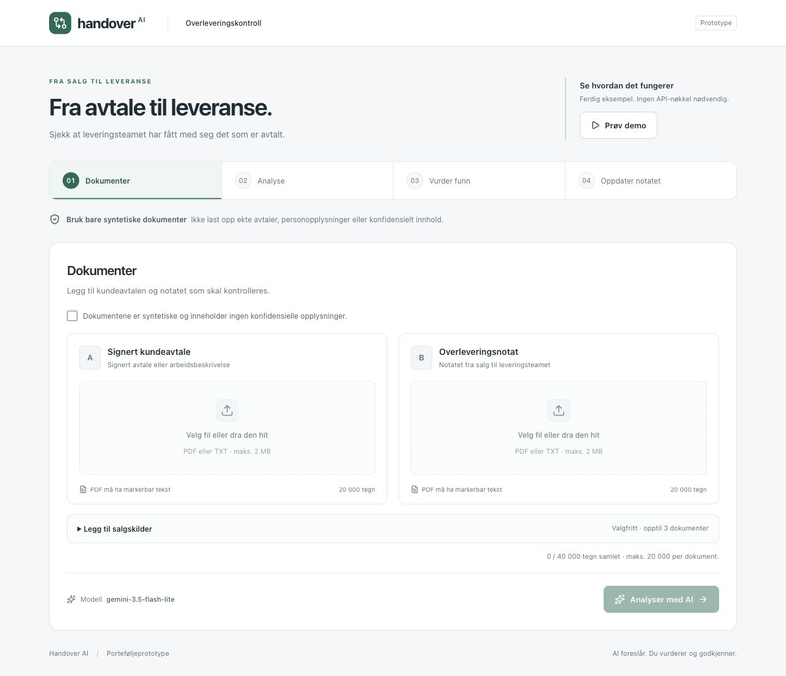
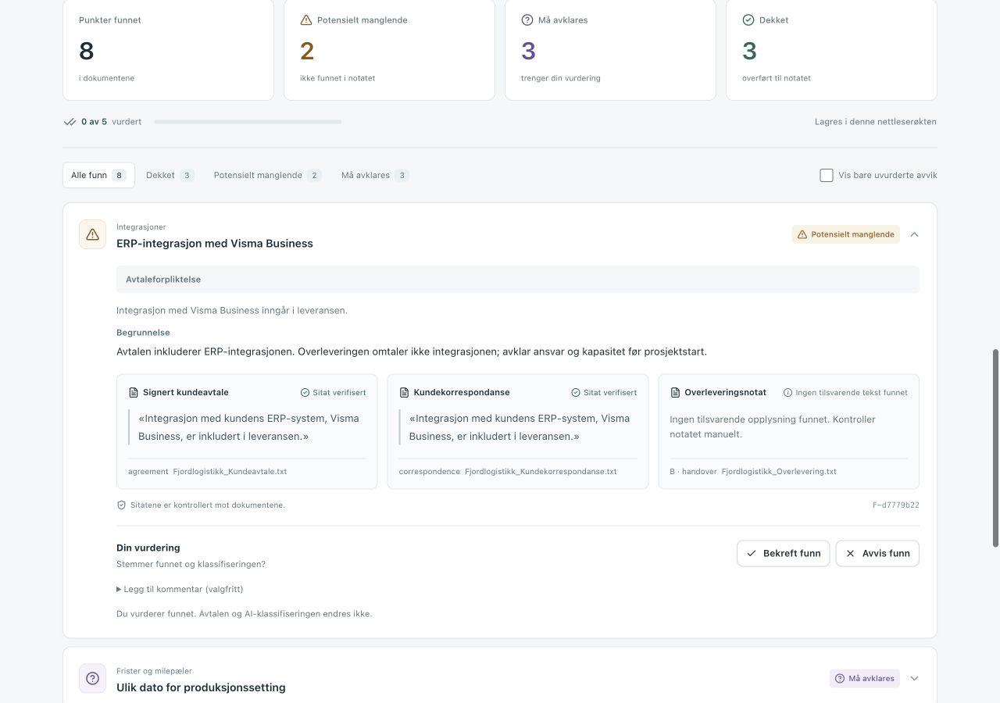
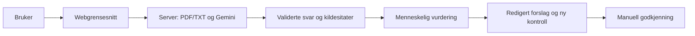

# Handover AI

Handover AI sammenligner en kundeavtale og andre salgskilder med et internt overleveringsnotat. Mulige mangler og konflikter vises med kildesitater. Brukeren vurderer funnene, får et forslag til oppdatert notat og kontrollerer det før manuell godkjenning.

En norsk porteføljeprototype utviklet med AI-assistanse. **Bruk bare syntetiske, ikke-konfidensielle dokumenter.** Demoen krever ingen API-nøkkel.

**Vil du prøve prototypen?** Den kjøres på din egen maskin. Følg [oppstartsveiledningen](#kjør-lokalt) først, og velg deretter **Prøv demo** i appen. Skjermbildene nedenfor viser arbeidsflyten uten at du trenger å installere noe.

## Problemet

Når en programvareleveranse går fra salg til prosjektleder, kan en integrasjon bli utelatt, en dato feil gjengitt eller et kundeønske fremstå som avtalt. Informasjonen kan ligge spredt i avtaler, tilbud og e-poster. Handover AI gir et kontrollpunkt før prosjektstart. Om dette reduserer tidsbruk og omarbeid, er foreløpig ikke målt.

## Slik fungerer det

1. Last opp én signert kundeavtale og ett overleveringsnotat. Legg eventuelt til tilbud, kundekorrespondanse og møtenotater, én fil av hver type. Dokumenter med identisk tekst må byttes før analysen kan starte.
2. Kjør analyse. Funn vises som **Dekket**, **Potensielt manglende** eller **Må avklares**, med sitater fra de aktuelle dokumentene.
3. Vurder mangler og avklaringspunkter. Dekkede krav kan kontrolleres, men krever ingen beslutning. Hvis analysen ikke finner noen punkter, må du kontrollere dokumentene før du starter på nytt. Forslag krever minst ett funn.
4. Generer og rediger et oppdatert notat. Se tekstendringene, kjør ny kontroll og godkjenn notatet manuelt. Det kan lastes ned som TXT.

Avtalen er primærkilde for avtalte forpliktelser. Salgskilder kan dokumentere ønsker og konflikter, men endrer ikke avtalen. Ved ny kontroll beholdes alle opprinnelige funn og kilder. En åpen sak som er korrekt overført, vises som **Overført med oppfølging**. Den er dokumentert, men ikke løst.

Velg **Prøv demo** for et ferdig eksempel med manglende ERP-integrasjon, feil dato og en kundee-post som motsier avtalens avgrensning. Demoens analyse er forhåndsberegnet. Forslag og ny kontroll bruker avgrensede lokale regler, uten Gemini-kall.

## Skjermbilder

Startskjerm og dokumentopplasting:



Funn med kilder og menneskelig vurdering:



[Se mobilvisningen](docs/screenshots/mobile.jpg).

## Teknologi og arkitektur

Next.js App Router, React, TypeScript og Tailwind CSS. Gemini kalles gjennom offisiell `@google/genai`. Zod validerer data, `pdf-parse` henter PDF-tekst og Vitest brukes til programvaretester.



Gemini tolker innholdet. Applikasjonskode kontrollerer struktur, kildesitater og at alle opprinnelige funn følger med videre. API-nøkkelen finnes bare på serveren. Ingen database, innlogging eller permanent dokumentlagring brukes. Se [teknisk guide](docs/technical-guide.no.md) for designvalg og dataflyt.

## Kjør lokalt

### 1. Installer Node.js og pnpm én gang

Installer **Node.js 24 LTS** fra [nodejs.org](https://nodejs.org/en/download). Velg installasjonsprogrammet for operativsystemet ditt. Det installerer både Node.js og npm. Prosjektet krever minst Node.js 22.13.

Lukk og åpne VS Code eller terminalprogrammet på nytt etter installasjonen. Åpne en terminal og kontroller at verktøyene finnes:

```sh
node --version
npm --version
```

Begge skal vise et versjonsnummer. Installer deretter prosjektets versjon av pnpm:

```sh
npm install --global pnpm@11.25.0
pnpm --version
```

Den siste kommandoen skal vise `11.25.0`. Se [pnpm sin installasjonsguide](https://pnpm.io/installation) hvis installasjonen feiler.

### 2. Last ned og åpne prosjektet

På GitHub: velg **Code → Download ZIP**, pakk ut filen og åpne prosjektmappen i VS Code med **File → Open Folder**. Velg mappen som inneholder `package.json`, ikke mappen over den. Har du allerede lastet ned eller klonet prosjektet, bruker du den eksisterende mappen.

Velg **Terminal → New Terminal** i VS Code. Kommandoene nedenfor skal kjøres i prosjektmappen. Du kan også bruke en vanlig terminal hvis du først går til samme mappe.

### 3. Installer pakkene og start appen

Kjør én kommando om gangen. Vent til installasjonen er ferdig før du starter appen:

```sh
pnpm install --frozen-lockfile
pnpm dev
```

Den første kommandoen installerer prosjektets avhengigheter med versjonene i låsefilen. Den andre starter den lokale serveren.

Når terminalen viser **Ready**, finner du nettadressen på linjen **Local**, normalt [http://127.0.0.1:3000](http://127.0.0.1:3000). Åpne adressen i nettleseren. I VS Code kan du holde **Command** på Mac eller **Ctrl** på Windows/Linux inne og klikke på den. Bruk adressen terminalen faktisk viser hvis porten er en annen.

**Lokaladressen virker først etter at serveren er startet på din maskin.** Nettleseren åpnes ikke automatisk. La terminalen stå åpen mens du bruker appen; at den blir stående uten ny tekst, er normalt. Stopp serveren med **Ctrl+C**.

Velg **Prøv demo** for å gå gjennom hele arbeidsflyten uten API-nøkkel. Neste gang trenger du bare å åpne prosjektmappen og kjøre `pnpm dev`.

For egne live-tester finnes både de [korte Fjordlogistikk-eksemplene i TXT](public/examples) og et [lengre Vestvik-eksempel med tre PDF-er](public/examples/pdf/README.md). PDF-settet har ti sider totalt og er et separat, syntetisk prosjekt.

**Hvis oppstarten stopper:**

- `command not found: node`, `npm` eller `pnpm`: Verktøyet er ikke installert eller tilgjengelig i terminalen. Fullfør steg 1 og åpne en ny terminal.
- `Another next dev server is already running`: Stopp den tidligere serveren med **Ctrl+C** i terminalen der den kjører, og start på nytt. Å lukke nettleserfanen stopper ikke serveren.

### Live-analyse med Gemini

For å analysere opplastede dokumenter med AI trenger du en nøkkel fra [Google AI Studio](https://aistudio.google.com/apikey). Kopier `.env.example` til `.env.local` i prosjektmappen hvis filen ikke finnes, og fyll inn:

```dotenv
GEMINI_API_KEY=din_lokale_nokkel
GEMINI_MODEL=gemini-3.8-flash
```

Start serveren på nytt etter endringen: **Ctrl+C**, deretter `pnpm dev`. Last opp syntetiske dokumenter i appen, bekreft at de ikke inneholder konfidensielt innhold, og velg **Analyser med AI**. Eksempelfiler ligger i [`public/examples`](public/examples).

Velg en modell du har tilgang til; tidligere live-tester brukte eksplisitt `gemini-3.5-flash-lite`. Appen bytter ikke modell automatisk og erstatter ikke feil med demodata. Tilgang og kvoter avhenger av Google-prosjektet ditt. Appen aktiverer ikke fakturering.

`.env.local` skal forbli lokal og er ignorert av Git. Bruk aldri `NEXT_PUBLIC_` på nøkkelen. Ved live-analyse, forslagsgenerering og ny kontroll sendes dokumentteksten til Google Gemini. Se [sikkerhetsrutinen](SECURITY.md).

For å kjøre produksjonsbygget lokalt, stopp utviklingsserveren og kjør:

```sh
pnpm build
pnpm start
```

## Testing og begrensninger

```sh
pnpm test
pnpm lint
pnpm build
pnpm typecheck
pnpm secrets:check
```

Kjør bygg før separat TypeScript-kontroll fordi Next.js genererer typer under bygg. Testene dekker blant annet filvalidering, kildesitater, beslutningsregler, forslag og ny kontroll. Gemini-svar mockes i automatiske tester; dette måler ikke modellens treffsikkerhet. Se [kontrollstatus og evaluering](docs/verification.md).

En historisk live-kjøring med ti syntetiske dokumentpar ligger i [rårapporten](docs/evaluation-gemini-3.5-flash-lite-2026-10-20.json). Den gjelder en eldre todokumentversjon. Det lille testgrunnlaget gir ingen generell presisjonsmåling. Ny kjøring med lokal nøkkel: `pnpm evaluate --live`. Det bruker API-kvote og lagrer rapporten lokalt i ignorert `evaluation-results/`.

Viktige begrensninger:

- PDF med markerbar tekst eller TXT. Maksimalt 2 MiB og 20 000 tegn per fil, 40 PDF-sider og 40 000 tegn samlet. Ingen OCR eller skjult avkorting.
- AI kan overse innhold og tolke et korrekt sitat feil. Fast kontrollgrunnlag beskytter bare funn som ble oppdaget første gang.
- Et forslag må leses av brukeren. Ingen automatisk juridisk godkjenning eller garanti for fullstendighet gis.
- Demoens lokale kontroll gjenkjenner bare kjente formuleringer, ikke vilkårlig redigert tekst.
- Lokal struping og kildekontroll gjør ikke prototypen klar for offentlig drift. En ny sideåpning nullstiller arbeidsøkten.
