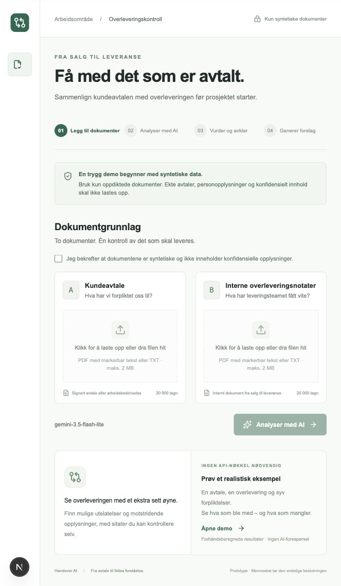
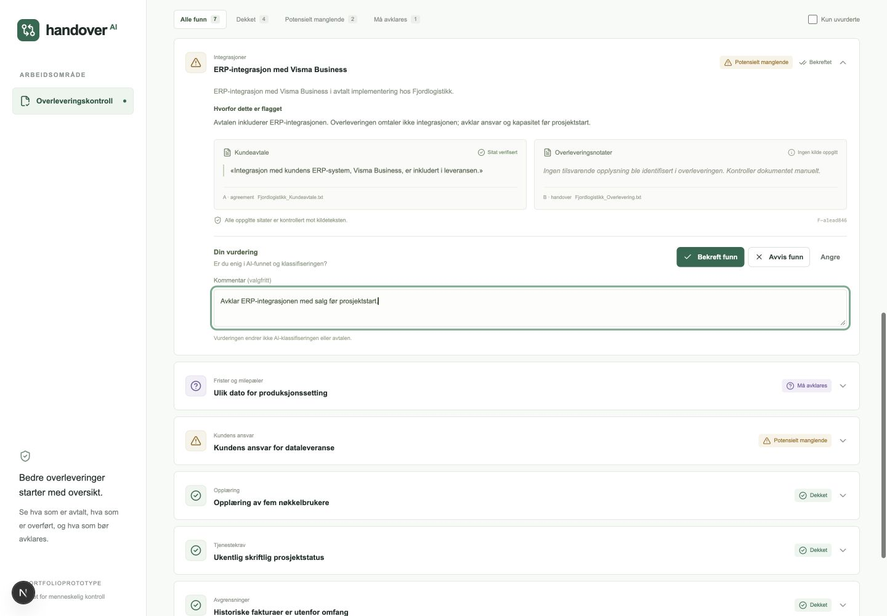
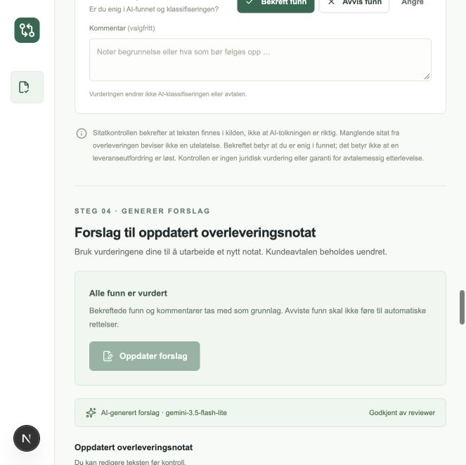
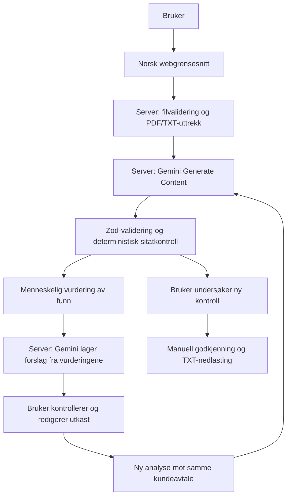

# Handover AI

**Fra signert kundeavtale til en etterprøvbar overlevering.** Handover AI sammenligner en kundeavtale med interne overleveringsnotater, viser mulige mangler med kildesitater og lar en fagperson vurdere hvert funn. Etter gjennomgangen kan AI lage et oppdatert notat som kontrolleres på nytt før manuell godkjenning.

Et portfolioprosjekt utviklet av en nyutdannet MSc-kandidat i Information Systems – Business Analytics. Prosjektet demonstrerer ett komplett arbeidsløp med prosessforståelse, fullstack-utvikling, AI-integrasjon og kvalitetssikring. Grensesnittet er på norsk. Demoen fungerer uten API-nøkkel.

## For tekniske rekrutterere

| Område                | Hva prosjektet viser                                                                                       |
| --------------------- | ---------------------------------------------------------------------------------------------------------- |
| Forretningsforståelse | Et konkret kontrollpunkt mellom salg og prosjektleveranse, med målbare hypoteser om nytte.                 |
| Fullstack-utvikling   | Next.js App Router, TypeScript, React, Tailwind CSS og serverbasert PDF/TXT-behandling.                    |
| AI-integrasjon        | Offisiell Google Gen AI SDK, strukturerte svar, Zod-validering og håndtering av kvoter og feil.            |
| Etterprøvbarhet       | Ordrette kildesitater kontrolleres deterministisk. AI-forslag og menneskelige beslutninger lagres separat. |
| Kvalitetssikring      | Automatiske tester uten API-forbruk og en dokumentert live-evaluering med ti syntetiske dokumentpar.       |
| Avgrensning           | Ingen database, innlogging, OCR, CRM-integrasjon eller agentrammeverk. Ett komplett arbeidsløp.            |

## Forretningsproblemet

Når en B2B-programvareavtale går fra salg til prosjektleder eller implementeringsteam, kan forpliktelser være fordelt på flere dokumenter. En ERP-integrasjon kan bli utelatt, en leveransedato feil gjengitt eller kundens dataansvar uklart. Det kan skape feil forventninger, koordinering og omarbeid.

Handover AI undersøker om AI-støttet sammenligning med kildebelegg kan hjelpe selgere, prosjektledere og implementeringskonsulenter å oppdage slike forhold før oppstart. **Redusert omarbeid og bedre overleveringer er hypoteser, ikke dokumenterte kommersielle gevinster.** Verktøyet gir ingen juridiske avgjørelser og endrer ikke kundeavtalen.

## Arbeidsflyt

1. **Legg til dokumenter:** Bekreft at innholdet er syntetisk. Last opp kundeavtale og overleveringsnotater som PDF med markerbar tekst eller UTF-8 TXT. Kontroller uttrukket tekst.
2. **Analyser med AI:** Gemini identifiserer forpliktelser og sammenligner betydningen i de to dokumentene. Funn klassifiseres som **Dekket**, **Potensielt manglende** eller **Må avklares**.
3. **Vurder og avklar:** Åpne kildesitater, filtrer funn, bekreft eller avvis hvert funn og legg eventuelt til kommentar. Bekreftet betyr at du er enig i funnet, ikke at problemet er løst.
4. **Generer forslag:** Når alle funn er vurdert, vises **Oppdater forslag**. Les og rediger utkastet, analyser det mot den samme kundeavtalen, undersøk gjenstående problemer og godkjenn notatet manuelt. Last ned som TXT.

Endringer i dokumenter nullstiller analysen. Endringer i utkastet eller vurderingsgrunnlaget gjør tidligere kontroll og godkjenning ugyldig. En ny sideåpning starter med tom kontroll; ingen tidligere resultater vises automatisk.

## Skjermbilder

Skjermbildene viser bare syntetiske eksempler fra de fiktive selskapene Nordlys Programvare AS og Fjordlogistikk AS.

### Dokumentgrunnlag



### Kildebelegg og menneskelig vurdering



### Forslag etter fullført gjennomgang



## Arkitektur



Alle Gemini-kall går via serveren. API-nøkkelen leses fra lokale miljøvariabler og sendes aldri til nettleseren. Dokumenttekst behandles som ubetrodd data; instruksjoner i dokumenter skal ikke følges. Modellens JSON-svar valideres med Zod før bruk.

AI gjør den semantiske tolkningen. Applikasjonskode kontrollerer kildesitater med normalisert Unicode og mellomrom, beregner verifikasjonsstatus og oppretter funn-ID-er. Uverifiserte sitater og tvetydig avtalespråk gir **Må avklares**. Mennesket eier beslutningene. Et verifisert sitat beviser at teksten finnes, ikke at tolkningen er riktig.

| Teknologi                                          | Bruk                                             |
| -------------------------------------------------- | ------------------------------------------------ |
| Next.js App Router, React og TypeScript            | Grensesnitt og serverruter i samme prosjekt      |
| Tailwind CSS, Radix Slot og lokal Button-komponent | Tilgjengelige kontroller med shadcn/ui-mønster   |
| `@google/genai`                                    | Generate Content med strukturert JSON            |
| Zod                                                | Input, modellresponser, resultater og reviewdata |
| `pdf-parse`                                        | Serverkompatibelt uttrekk fra PDF med tekst      |
| Vitest                                             | Isolerte tester og SDK-mock uten API-kvote       |

```text
src/app/api/documents/    Filvalidering og tekstuttrekk
src/app/api/analyze/      Live-sammenligning og validerte resultater
src/app/api/proposal/     Forslag etter fullført menneskelig vurdering
src/components/          Dokumentfelt, funn, vurdering og forslagseditor
src/lib/                 Skjemaer, sitatkontroll, demo og reviewlogikk
src/lib/server/          Gemini-integrasjon, feil og forespørselsgrenser
evaluation/              Ti syntetiske dokumentpar og poengberegning
tests/                   Automatiske tester uten live-kall
scripts/                 Live-evaluering og lokal hemmelighetskontroll
public/examples/         Syntetiske TXT-dokumenter
docs/                    Skjermbilder, teknisk guide og faktisk evalueringsrapport
```

## Kjør lokalt

Forutsetninger: **Node.js 22.13+**, **pnpm 11.25** og Git. Installer avhengighetene med den innlåste avhengighetsfilen:

```sh
pnpm install --frozen-lockfile
pnpm dev
```

Åpne [http://127.0.0.1:3000](http://127.0.0.1:3000) og velg **Åpne demo**. Ingen nøkkel eller Google-konto kreves for demoen.

### Valgfri live-analyse med Gemini

1. Opprett din egen nøkkel i [Google AI Studio](https://aistudio.google.com/apikey).
2. Hvis `.env.local` ikke allerede finnes, kopier malen:

```sh
cp .env.example .env.local
```

3. Rediger bare den lokale `.env.local`-filen:

```dotenv
GEMINI_API_KEY=
GEMINI_MODEL=gemini-3.8-flash
```

Fyll inn din egen nøkkel etter `GEMINI_API_KEY=` og start utviklingsserveren på nytt. **Nøkkelen skal ikke deles, legges i README eller få `NEXT_PUBLIC_`-prefiks.** `.env.local` er ignorert av Git; `.env.example` inneholder bare tom nøkkel og modellnavn.

Standardmodellen er `gemini-3.8-flash`. Den dokumenterte live-evalueringen brukte eksplisitt `gemini-3.5-flash-lite`. Sett selv `GEMINI_MODEL` til en modell prosjektet ditt har tilgang til. Tilgang og gratis kvoter er ikke garantert; appen aktiverer ikke fakturering og bytter aldri modell automatisk. Modellnavnet vises i grensesnittet. API-feil vises som feil og erstattes aldri av demodata.

Bruk **bare syntetiske, ikke-konfidensielle dokumenter**. Ved live-analyse og forslagsgenerering sendes teksten til Google Gemini. Ingen dokumenter lagres permanent på serveren av applikasjonen; Googles databehandling følger prosjektets tjenestevilkår og innstillinger.

### Demo og live er tydelig atskilt

|                 | Demo                                         | Live                                                      |
| --------------- | -------------------------------------------- | --------------------------------------------------------- |
| Dokumenter      | Medfølgende syntetiske eksempler             | Opplastede syntetiske PDF/TXT-filer, eller eksempelfilene |
| Første analyse  | Forhåndsberegnede, validerte funn            | Faktisk Gemini-kall                                       |
| Oppdatert notat | Merket, regelbasert utkast                   | Faktisk Gemini-kall med beslutninger og kommentarer       |
| Ny kontroll     | Begrenset kontroll av kjente eksempelsitater | Ny Gemini-analyse mot samme avtale                        |
| Nøkkel          | Ikke nødvendig                               | Lokal servernøkkel nødvendig                              |

For en demonstrasjon på 2–3 minutter: åpne demoen, vis manglende ERP-integrasjon og motstridende datoer, sammenlign «fem superbrukere» med «fem nøkkelbrukere», vurder alle funn og vis forslag, ny kontroll og godkjenning. Demoens kontroll er ikke en generell semantisk analyse av frie redigeringer.

### Produksjonsbygg lokalt

```sh
pnpm build
pnpm start
```

Bygget bruker Webpack for å fungere i begrensede utviklingsmiljøer. Dette er en lokal prototype. Et offentlig kildekoderepositorium innebærer ikke at den nøkkeldrevne serveren bør eksponeres offentlig.

## Tester og evaluering

```sh
pnpm test
pnpm lint
pnpm build
pnpm typecheck
pnpm secrets:check
```

Kjør bygg og separat TypeScript-kontroll etter hverandre; Next.js regenererer typefiler under bygg. Testene bruker SDK-mock og ekte lokal PDF/TXT-ekstraksjon, uten å bruke Gemini-kvote. De dekker blant annet filgrenser, ugyldige svar, sitatkontroll, klassifisering, review, forslag, foreldede godkjenninger og hemmelighetskontrollen. Se [verifiseringsloggen](docs/verification.md) for faktisk kjørt status.

### Faktiske evalueringsresultater

Én live-kjøring **20. oktober 2026** med `gemini-3.5-flash-lite` fullførte **10 av 10 syntetiske dokumentpar uten API-feil**. Dette er historiske, lagrede resultater, ikke et løfte om dagens modelltilgang eller fremtidig kvalitet.

| Måling                                         | Resultat       |
| ---------------------------------------------- | -------------- |
| Korrekt identifiserte utelatelser              | 4              |
| Oversette utelatelser                          | 0              |
| Falske positive problemfunn                    | 0              |
| Klassifiseringsnøyaktighet med streng matching | 71,4 % (10/14) |

Poengberegningen krever både riktig kategori og overlappende ordrett avtaleanker. To korrekt dekkede forpliktelser i tilfelle 07 fikk andre kategorier enn fasiten og ble derfor regnet som umatchede krav og ekstra funn. **71,4 % er et kategoriavhengig matcherresultat, ikke en ren måling av semantisk klassifisering.** Fasiten og poengregelen er ikke endret for å forbedre resultatet.

Datasettet dekker mangler, semantisk likhet, datokonflikter, ansvar, avgrensninger, tvetydighet, korrekt overførte krav, flere krav i ett avsnitt, irrelevant innhold og prompt injection. Det lille, håndlagde settet og én kjøring dokumenterer ikke generell modellpresisjon eller kommersiell effekt. Forslagsgenerering er funksjonstestet separat og omfattes ikke av denne poengsummen.

Se [rårapporten med faktiske modellresponser](docs/evaluation-gemini-3.5-flash-lite-2026-10-20.json), [datasettet](evaluation/dataset.ts) og [poengberegningen](evaluation/score.ts).

Kjør ny live-evaluering med lokal nøkkel:

```sh
pnpm evaluate --live
# Eventuelt bare ett dokumentpar:
pnpm evaluate --live --case=02-semantic-training
```

Dette sender faktiske forespørsler og bruker prosjektets kvote. Resultater lagres i ignorert `evaluation-results/`. Skriptet bruker ingen forhåndsberegnede svar eller automatisk retry. Nye rapporter må gjennomgås for konfidensielt innhold før de eventuelt legges i `docs/`.

## Sikkerhet og avgrensninger

- PDF/TXT: maksimalt 2 MiB og 20 000 teksttegn per dokument, 40 PDF-sider og 40 funn. Skannede og teksttomme PDF-er avvises; ingen OCR.
- Servervalidering, størrelsesbegrenset body, origin-kontroll og enkel struping. Analyse, forslag og ny kontroll deler fem AI-kall per ti minutter og én samtidig forespørsel per prosess.
- Dokumenter og svar gjengis som tekst. Modellsvar og rå leverandørfeil brukes ikke som HTML eller logges som dokumentinnhold.
- Reviewdata beholdes lokalt i den aktive nettleserøkten. Utkast og godkjenning ligger i minnet; en ny sideåpning nullstiller kontrollen.
- PDF-uttrekk kan gi feil leserekkefølge. En modell kan overse krav eller tolke et verifisert sitat feil. Systeminstrukser eliminerer ikke prompt injection.
- Ny analyse vurderer dekning av avtalen og fanger ikke nødvendigvis alle udokumenterte tillegg i et generert notat. Menneskelig kontroll er nødvendig, også ved null flaggede mangler.
- Strupingen er prosessbasert og ingen erstatning for autentisering eller produksjonssikring. Ingen juridisk godkjenning eller garanti for etterlevelse gis.

`.gitignore` utelater miljøfiler, sertifikater, private mapper, logger, lokale evalueringer og byggeoutput. `pnpm secrets:check` kontrollerer publiserbare filer og lokale Git-objekter, inkludert historikk, staging og utilgjengelige objekter, uten å skrive ut hemmelighetsverdier. Kontrollen bruker kjente tokenmønstre og hemmeligheter fra lokale miljøfiler; den kan ikke bevise at vilkårlig innhold er ikke-konfidensielt. Se [sikkerhetsrutinen](SECURITY.md) og [den lokale publiseringskontrollen](docs/repository-readiness.md).

## Videre utvikling

Neste relevante steg er flere uavhengig merkede syntetiske tilfeller, bedre PDF-uttrekk og en brukertest med prosjektledere. En effektstudie bør sammenligne manuell og AI-støttet gjennomgang på samme oppgaver og måle tidsbruk, oversette feil, falske alarmer og opplevd nytte.

Mer om designvalg, skjemaer, begrensninger og måledefinisjoner finnes i [den tekniske guiden](docs/technical-guide.no.md).
