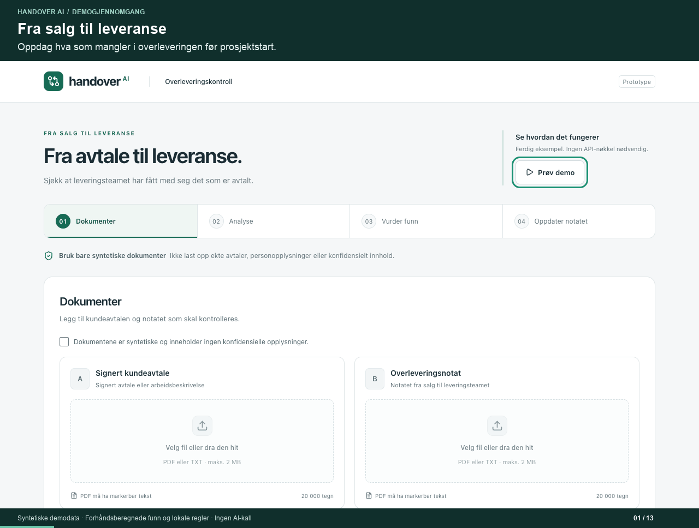
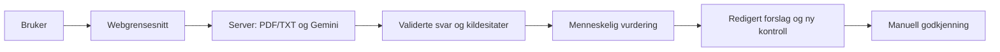

# Handover AI

**Handover AI** er en porteføljeprototype som bruker generativ AI til å kontrollere om viktig informasjon fra en kundeavtale og andre salgskilder er overført til et internt overleveringsnotat.

Når et salg går over til leveranse, kan krav, tidsfrister og spesielle kundebetingelser bli oversett eller gjengitt feil. Løsningen skal gjøre slike mulige mangler og konflikter enklere å oppdage før prosjektstart.

Prototypen er utviklet med AI-assistanse. Bruk kun **syntetiske, ikke-konfidensielle dokumenter**.

## Se løsningen



[Åpne demonstrasjonen i full størrelse](docs/demo/handover-ai-demo.gif) · [Skjermbilde av opplasting](docs/screenshots/start.jpg) · [Skjermbilde av funn](docs/screenshots/review.jpg) · [Mobilvisning](docs/screenshots/mobile.jpg)

GIF-en viser arbeidsflyten med syntetiske dokumenter og forhåndsberegnede funn. **Demoen bruker ikke Gemini eller en API-nøkkel**; forslag og sluttkontroll følger lokale regler laget for eksemplet. For faktisk AI-analyse må appen kjøres lokalt med egen Gemini-nøkkel.

## Slik fungerer det

1. **Last opp dokumenter:** Kundeavtale og overleveringsnotat er obligatoriske. Tilbud, kundekorrespondanse og møtenotater kan legges til.
2. **Analyser:** Gemini sammenligner dokumentene og identifiserer punkter som er **Dekket**, **Potensielt manglende** eller **Må avklares**, med henvisninger til kildetekst.
3. **Vurder funnene:** Brukeren gjennomgår mulige mangler og konflikter før det genereres et forslag til oppdatert overleveringsnotat.
4. **Kontroller og godkjenn:** Brukeren kan redigere forslaget, sammenligne endringer, kjøre en ny kontroll og godkjenne notatet manuelt. Notatet kan lastes ned som TXT.

Den signerte avtalen er primærkilden for avtalte forpliktelser. Opplysninger i e-post eller tilbud kan vise ønsker eller konflikter, men gjør dem ikke automatisk til avtalekrav. Åpne saker kan følge med som oppfølgingspunkter uten å bli markert som løst.

## Teknologi og design

**Stack:** Next.js, React, TypeScript, Tailwind CSS, Google Gemini (`@google/genai`), Zod, `pdf-parse` og Vitest.



**Gemini tolker dokumentinnholdet.** Applikasjonskoden validerer svarstrukturen, kontrollerer at oppgitte sitater finnes i kildedokumentene, og beholder opprinnelige funn gjennom den nye kontrollen. Et korrekt sitat garanterer likevel ikke at AI-ens tolkning er riktig.

API-kall skjer på serveren. Prototypen har ingen database, innlogging eller permanent dokumentlagring. Se [teknisk guide](docs/technical-guide.no.md) for dataflyt og designvalg.

## Kjør lokalt

**Krav:** Node.js 22.13 eller nyere og pnpm 11.25.0. Installer pnpm ved behov med `npm install --global pnpm@11.25.0`.

Last ned eller klon repositoriet. Kjør fra prosjektmappen:

```sh
pnpm install --frozen-lockfile
pnpm dev
```

Åpne adressen som vises i terminalen (normalt `http://127.0.0.1:3000`). Velg **Prøv demo** for å teste hele eksempelflyten uten API-nøkkel.

### Live-analyse med Gemini

Opprett en lokal `.env.local` fra `.env.example` og legg inn en nøkkel fra [Google AI Studio](https://aistudio.google.com/apikey):

```dotenv
GEMINI_API_KEY=din_lokale_nokkel
GEMINI_MODEL=gemini-3.8-flash
```

Bruk en modell kontoen din har tilgang til, og start `pnpm dev` på nytt. De [syntetiske TXT-eksemplene](public/examples) og [PDF-eksemplene](public/examples/pdf/README.md) kan brukes til testing. Tidligere live-evalueringer ble gjort med `gemini-3.5-flash-lite`; tilgang og kvoter kan variere.

Ikke legg ut API-nøkler eller ekte kundeinformasjon. Ved live-kall sendes dokumenttekst til Gemini. Se [SECURITY.md](SECURITY.md).

## Testing og begrensninger

Programvaretester dekker blant annet dokumentvalidering, kildesitater, beslutningsregler, forslag og sluttkontroll. De bruker mockede Gemini-svar og måler **ikke** hvor ofte modellen finner alle relevante krav.

```sh
pnpm test
pnpm lint
pnpm build
pnpm typecheck
pnpm secrets:check
```

Kjør `pnpm build` før separat typekontroll. [Verifisering og evaluering](docs/verification.md) dokumenterer testresultater, faktiske modellkjøringer og kjente feil.

**Viktige begrensninger:** Dette er en lokal prototype, ikke en produksjonsklar løsning. Den støtter tekstbaserte PDF-er og TXT-filer, men ikke OCR. Gemini kan overse krav eller feiltolke dokumenter; derfor kreves menneskelig vurdering og manuell godkjenning. Demoens lokale regler gjelder bare det medfølgende eksemplet.
