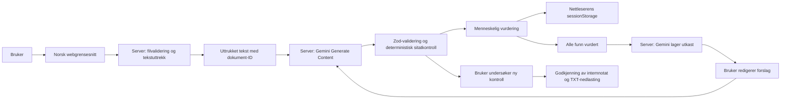

# Handover AI

**AI-støttet kontroll av overleveringen fra salg til leveranse.** Et avgrenset portfolioprosjekt for å demonstrere prosessforståelse, fullstack-utvikling, AI-integrasjon og kvalitetssikring. Norsk grensesnitt. Ingen innlogging, database eller dokumentarkiv.

## Problemet og hypotesen

En kundeavtale kan inneholde leveranseforpliktelser som ikke følger med til prosjektleder og implementeringsteam. En integrasjon kan bli glemt, en dato endret eller kundens ansvar uklart. Det kan føre til mer koordinering, omarbeid og feil forventninger.

Handover AI undersøker om en sammenligning med kildebelegg kan hjelpe teamet å oppdage slike forhold før oppstart. **Mindre omarbeid, raskere overleveringer og bedre kundetilfredshet er hypoteser, ikke dokumenterte gevinster.** Prototypen gir ingen juridisk vurdering, endrer ikke avtaler og garanterer ikke etterlevelse.

Målgruppen er selgere, prosjektledere og implementeringskonsulenter som skal overføre et solgt programvareprosjekt til leveringsteamet.

## Kom i gang

Forutsetninger: Node.js **22.13 eller nyere** og pnpm **11.25**. En API-nøkkel er ikke nødvendig for demoen. Prosjektet bruker en innlåst avhengighetsfil, `pnpm-lock.yaml`.

```sh
pnpm install --frozen-lockfile
pnpm dev
```

Åpne [http://127.0.0.1:3000](http://127.0.0.1:3000). Velg **Åpne demo** for å laste syntetiske dokumenter og forhåndsberegnede funn. Hele vurderingsflyten fungerer uten Gemini eller nettverk etter at appen er startet.

Produksjonsbygg lokalt:

```sh
pnpm build
pnpm start
```

Bygget bruker Next.js sin støttede Webpack-variant for å unngå problemer med Turbopacks prosesskommunikasjon i begrensede utviklingsmiljøer. Utviklingsserveren bruker standardmotoren.

## Arbeidsflyt

1. Bekreft at dokumentene er syntetiske. Last opp en kundeavtale og interne overleveringsnotater, eller velg **Åpne demo**.
2. Kontroller den uttrukne teksten med **Se tekst**. Endring av et dokument nullstiller tidligere analyser og vurderinger.
3. Velg **Analyser med AI** for en faktisk Gemini-forespørsel. Dette er en separat handling, også når demodokumentene er lastet inn.
4. Etter vellykket AI-analyse åpnes steg 03 «Vurder og avklar». Se antall dekkede, potensielt manglende og uklare forpliktelser. Filtrer listen og åpne funn for å sammenligne ordrette kildeutdrag.
5. Bekreft eller avvis hvert funn og legg eventuelt til en kommentar. **Bekreft funn** betyr at du er enig i vurderingen; det betyr ikke at leveranseproblemet er løst eller at avtalen er godkjent.
6. Når alle funn er vurdert, åpnes steg 04 **Generer forslag**, og **Oppdater forslag** vises nederst. Gemini bruker avtalen, det opprinnelige notatet, funnene, beslutningene og kommentarene til å lage et oppdatert utkast med endringsliste og avklaringsspørsmål. Avviste funn skal ikke gi automatiske rettelser.
7. Les og rediger utkastet. **Se opprinnelig overleveringsnotat** gir sammenligningsgrunnlaget. Velg **Analyser forslaget mot kundeavtalen** for en ny, separat analyse av den aktuelle tekstversjonen mot samme avtale.
8. Undersøk de nye funnene og eventuelle gjenstående mangler. **Godkjenn forslag** blir tilgjengelig etter den nye kontrollen. Godkjenning er din lokale beslutning om det interne notatet; den endrer ikke kundeavtalen. Notatet kan lastes ned som TXT. Redigering av teksten eller endrede vurderinger gjør tidligere kontroll og godkjenning ugyldig.

Vurderinger og kommentarer beholdes lokalt mens den aktuelle kontrollen er åpen, og lagres i `sessionStorage` for fanen. Hver ny sideåpning eller oppdatering starter en tom kontroll på steg 1; tidligere dokumenter og resultater gjenopprettes ikke automatisk. **Ny kontroll** nullstiller også innholdet. Resultater vises først etter vellykket AI-analyse, eller etter at brukeren uttrykkelig åpner den merkede demoen. Ingen dokumenter eller analyser skrives til serverens disk av applikasjonen. Hvis øktlagring er blokkert, fungerer vurderingene i minnet mens siden er åpen.

### Demo på 2–3 minutter

| Tid       | Vis                                                                                                 |
| --------- | --------------------------------------------------------------------------------------------------- |
| 0:00–0:30 | Forklar overleveringsproblemet. Velg **Åpne demo** og pek på merket «forhåndsberegnede resultater». |
| 0:30–1:00 | Vis ERP-integrasjonen som potensielt mangler, med verifisert sitat i avtalen.                       |
| 1:00–1:30 | Filtrer på **Må avklares** og vis 1. desember mot 15. desember i kildene.                           |
| 1:30–2:00 | Vis at «fem superbrukere» dekker «fem nøkkelbrukere»; sammenlign betydning, ikke bare ord.          |
| 2:00–2:30 | Vurder alle funn og legg inn en kommentar. Vis steg 04 og velg **Oppdater forslag**.                |
| 2:30–3:00 | Kontroller og rediger utkastet, kjør demokontrollen og vis godkjenning og TXT-nedlasting.           |

**Lukk demo** i demoens resultatfelt fjerner eksempeldokumenter, funn og vurderinger og går tilbake til en tom kontroll på steg 1. Demoen kan åpnes på nytt fra eksempelpanelet.

Demoen gjelder de fiktive selskapene **Nordlys Programvare AS** og **Fjordlogistikk AS**. Den har syv forpliktelser: to potensielt manglende, én datokonflikt og fire dekkede. Eksempelfilene ligger i `public/examples/` og kan lastes opp som vanlige TXT-filer. Demoresultatene valideres av de samme Zod-skjemaene og sitatfunksjonene som live-resultatene. De er ikke målinger av Gemini.

## Konfigurere Gemini

1. Opprett din egen nøkkel i [Google AI Studio](https://aistudio.google.com/apikey).
2. Kontroller modelltilgang og gjeldende [kvoter](https://ai.google.dev/gemini-api/docs/rate-limits) i prosjektet ditt. Tilgang til en modell eller gratis kvote er ikke garantert av appen.
3. Kopier miljøeksempelet:

```sh
cp .env.example .env.local
```

4. Rediger `.env.local` lokalt:

```dotenv
GEMINI_API_KEY=
GEMINI_MODEL=gemini-3.8-flash
```

5. Start utviklingsserveren på nytt. Den konfigurerte modellen vises ved analyseknappen. Faktisk tilgang testes ved forespørselen; eventuelle feil vises når analysen kjøres.

Standardmodellen i kildekoden og miljøeksempelet er fortsatt `gemini-3.8-flash`. Den dokumenterte evalueringen brukte `gemini-3.5-flash-lite` for den dokumenterte live-kjøringen. Velg denne verdien i `GEMINI_MODEL` hvis du vil demonstrere med samme modell. Dette er en eksplisitt konfigurasjon, ikke automatisk fallback.

Nøkkelen leses bare av serverkode. Den har aldri `NEXT_PUBLIC_`-prefiks, returneres ikke i API-svar og skal ikke legges i Git. Appen aktiverer ikke fakturering, endrer ikke Google-prosjektet og bytter aldri modell automatisk. Dersom nøkkelen tilhører et prosjekt med fakturering, gjelder prosjektets egne betingelser; appen kan ikke avgjøre om en forespørsel er gratis. Bruk prosjektets kvotekontroller. Bare syntetisk, ikke-konfidensielt innhold skal behandles.

### Hvordan AI brukes

Serveren bruker offisiell **`@google/genai`**, `client.models.generateContent`, `responseMimeType: "application/json"` og `responseSchema`. SDK-skjemaet utledes fra Zod med støttede felttyper og nullable-felt. Lengde- og antallsgrenser håndheves med Zod etter mottak; resultatet parses og valideres med Zod før bruk. Se Googles [GenerateContent-konfigurasjon](https://googleapis.github.io/js-genai/release_docs/interfaces/types.GenerateContentConfig.html) og [strukturerte utdata](https://ai.google.dev/gemini-api/docs/structured-output).

Den første forespørselen identifiserer forpliktelser i dokument `agreement` og sammenligner dem med `handover`. Dokumenttekst sendes med eksplisitte kilde-ID-er i en JSON-datablokk. En separat systeminstruks beskriver at innholdet er ubetrodd data, at innebygde instruksjoner skal ignoreres og at tolkningen skal være forsiktig. Ingen verktøy eller URL-oppslag er aktivert.

Det gjøres ingen automatiske nye forsøk, videreføringsforespørsler eller bytter til andre modeller. En pågående analyse låser handlingene, og et ferdig live-resultat kan ikke sendes på nytt uten å endre/nullstille dokumentgrunnlaget. Tidsgrensen er 60 sekunder; kvotefeil, manglende tilgang, ufullstendige resultater og ugyldig JSON vises med konkrete meldinger. En avbrutt forespørsel kan allerede ha brukt kvote hos Google. Feil erstattes aldri av demodata; hvis demoen allerede er synlig, beholder den sitt tydelige demomerke.

### Oppdatert notat, ny kontroll og godkjenning

Forslag er et eget serverkall gjennom den samme offisielle SDK-en, strukturerte utdata, Zod-validering og feilbehandling. Serveren krever at alle funn har en beslutning, avviser ukjente eller dupliserte ID-er og kontrollerer kildesitatene på nytt. Endringslisten får bare referere til kjente, bekreftede funn. Dette beviser ikke at hver tekstendring er semantisk riktig; brukerens gjennomgang og nye analyse er fortsatt nødvendig. Sammenligningen leter først og fremst etter dekning av forpliktelsene i kundeavtalen og oppdager ikke nødvendigvis alle nye, udokumenterte løfter i utkastet. Slike tillegg må også kontrolleres manuelt.

Generering og ny kontroll skjer bare ved eksplisitte knappetrykk. Gjentatte identiske forespørsler sperres i grensesnittet, og analyse, generering og ny kontroll deler serverens grense på fem AI-kall per ti minutter. Ingen annen modell velges ved feil. Utkastet overskriver ikke originalnotatet eller avtalen. Godkjenning knyttes til den kontrollerte teksten og de samme reviewerbeslutningene. Hvis brukeren endrer kommentarer eller beslutninger, beholdes utkastet synlig, men det merkes foreldet og må genereres på nytt før kontroll og godkjenning. Dersom ny analyse fortsatt flagger mangler, vises disse; applikasjonen godkjenner aldri automatisk.

I demo brukes **ingen AI-kall** til forslaget eller den nye kontrollen. Bekreftede mangler oppdateres med kjente avtaleutdrag; avviste funn beholdes uendret. Kommentarer legges i reviewernotater. Demokontrollen gjenkjenner bare de kjente formuleringene fra eksemplet og er tydelig merket som regelbasert. Den er ikke en generell semantisk analyse av brukerens redigeringer. Live-flyten bruker Gemini både til utkast og til ny analyse.

## Arkitektur og prosjektstruktur



```text
src/app/                    Side, layout og stilark
src/app/api/documents/      Midlertidig PDF/TXT-behandling
src/app/api/analyze/        Validert serverendepunkt for live-analyse
src/app/api/proposal/       Forslagsgenerering etter fullført vurdering
src/components/             Arbeidsflyt, kildevisning, vurdering og forslagseditor
src/components/ui/          Lokal shadcn/ui-inspirert Button med Radix Slot
src/lib/schemas.ts          Zod-skjemaer og TypeScript-typer
src/lib/evidence.ts         Sitatkontroll, stabile funn-ID-er og resultatbygging
src/lib/review.ts           Rene funksjoner for beslutninger, steg og øktdata
src/lib/proposal.ts         Forslagsskjema, beslutningskontroll og versjonsbinding
src/lib/proposal-demo.ts    Gjennomsiktig, regelbasert forslagsdemo
src/lib/file-validation.ts  Delte fil- og tekstgrenser
src/lib/files.ts            Serverkompatibelt tekstuttrekk med pdf-parse
src/lib/server/             Gemini, forespørselsgrenser og struping
src/lib/demo.ts             Syntetiske dokumenter og eksplisitte demofunn
evaluation/                Ti dokumentpar og deterministisk poengberegning
scripts/evaluate.ts         Live-evaluering uten demofallback
tests/                     Automatiske tester uten API-kvote
public/examples/           De to syntetiske TXT-eksempelfilene
```

Teknologi: Next.js App Router, TypeScript, React, Tailwind CSS, en liten lokal UI-komponent basert på shadcn/ui-mønsteret, Lucide-ikoner, Zod, Google Gen AI SDK, `pdf-parse` og Vitest. Ingen eksterne fonter eller dekorative bildeavhengigheter. Ingen database, autentisering, OCR, agentrammeverk eller vektorsøk. Forslag og godkjenning beholdes bare i minnet mens kontrollen er åpen; de gjenopprettes ikke etter en ny sideåpning.

### Ansvarsdeling og sporbarhet

| Lag                                                                                             | Eier                               |
| ----------------------------------------------------------------------------------------------- | ---------------------------------- |
| Tittel, beskrivelse, kategori, eksplisitt/tvetydig språk, forslag til klassifisering og sitater | Gemini, validert som ubetrodd svar |
| Funn-ID, kilde-ID-er, sitatstatus og eventuell sikkerhetsjustering av klassifisering            | Deterministisk applikasjonskode    |
| Bekreftet/avvist/uvurdert og kommentar                                                          | Menneskelig reviewer               |

`modelClassification` bevarer modellens opprinnelige forslag. `classification` er klassifiseringen brukt i listen etter kildekontroll. Et sitat som ikke finnes, tvetydig avtalespråk eller «Dekket» uten håndoverbelegg gir **Må avklares**. Når kontrollen endrer forslaget, vises både årsaken og opprinnelig AI-klassifisering. Review endrer ingen av disse feltene.

Sitatkontrollen sammenligner sammenhengende utdrag med riktig kilde, etter Unicode NFC og normalisering av mellomrom/linjeskift. Store/små bokstaver, datoer, ord og negasjoner endres ikke. Fraværende handoversitat er `not_provided`, ikke et verifisert bevis på utelatelse. Ingen sidetall oppgis. Funn-ID-er er deterministiske for normalisert avtalesitat, kategori og tittel; de er stabile innen analysen og for identiske funn, men ikke en garanti for samme ID på tvers av ulikt formulerte modellkjøringer.

## Grenser og sikkerhet

| Kontroll          | Grense                                                                               |
| ----------------- | ------------------------------------------------------------------------------------ |
| Filtyper          | PDF med markerbar tekst og UTF-8 TXT                                                 |
| Størrelse         | 2 MiB per fil                                                                        |
| PDF-sider         | Maksimalt 40                                                                         |
| Uttrukket tekst   | 20–20 000 tegn per dokument; for lang tekst avvises uten skjult avkorting            |
| PDF-tekst         | Sider med under 20 teksttegn avvises for å unngå stille utelatelse av skannede sider |
| Funn              | Maksimalt 40                                                                         |
| Live-forespørsler | 5 per 10 minutter, én samtidig per serverprosess                                     |
| Opplastinger      | 30 per minutt, to samtidig per serverprosess                                         |
| Kommentar         | Maksimalt 1 000 tegn                                                                 |

Forespørselskropper leses med en faktisk bytegrense også når `Content-Length` mangler. Filendelse, MIME, PDF-signatur, tekstinnhold, dokumentroller og samtykkefelt kontrolleres på serveren. Samme-opprinnelse kontrolleres for nettleserforespørsler. Tekst og AI-svar gjengis som tekst, aldri som rå HTML. Ingen dokumenttekst eller rå leverandørfeil logges av appen. Gemini-modulen brukes av serveren og evalueringsverktøyet, ikke klientkomponentene. API-ruter er merket `server-only`.

Strupingen er bevisst enkel og prosessbasert. Den nullstilles ved restart og deles ikke mellom serverinstanser. Origin-kontroll erstatter ikke autentisering. Dette er **en lokal prototype**, ikke en offentlig tjeneste med robuste misbruksgrenser. Ikke eksponer serveren offentlig uten separat vurdering av tilgang, parserisolasjon, kvoter og databehandling.

## Tester og evaluering

```sh
pnpm test
pnpm lint
pnpm typecheck
pnpm build
```

Vitest-testene bruker mock av Gemini-SDK-et og ekte lokal PDF/TXT-ekstraksjon. De dekker filgrenser, UTF-8, selekterbar/teksttom PDF, svarskjema, eksakte sitater, usikkert kildegrunnlag, stabile ID-er, duplikater, klassifiseringer, øktdata, kommentarer, bekreft/avvis/angre, kvotefeil, timeout, ufullstendige svar, origin-kontroll og størrelsesbegrenset JSON. **Beståtte tester med mock er ikke dokumentasjon på modellens presisjon.**

Evalueringssettet i `evaluation/dataset.ts` inneholder ti par med fasit for: eksplisitte mangler, semantisk like formuleringer, datokonflikt, kundens dataansvar, motstridende avgrensning, tvetydig avtalespråk, korrekt overførte krav, flere forpliktelser i ett avsnitt, irrelevante opplysninger og prompt injection.

Kjør en faktisk evaluering med konfigurert nøkkel:

```sh
pnpm evaluate --live
# Begrens til ett par ved behov:
pnpm evaluate --live --case=02-semantic-training
```

Skriptet bruker den samme Gemini-funksjonen som appen. Det sender sekvensielle forespørsler med pause mellom hvert par og lagrer faktiske modellresultater og feil i en ignorert `evaluation-results/live-*.json`. Det kjører ikke uten `--live` og bruker aldri forhåndsberegnede svar. Uten nøkkel stopper det med en tydelig feilmelding. For å spare kvote gjøres ingen automatisk retry.

Målinger er definert slik:

- **Korrekt identifiserte utelatelser:** fasit `potentially_missing` som er matchet og klassifisert likt av analysen.
- **Oversette utelatelser:** fasit `potentially_missing` som mangler eller får en annen klassifisering.
- **Falske positive funn:** ekstra funn flagget som manglende/uklare, samt flaggede problemer på forpliktelser som fasiten sier er dekket.
- **Klassifiseringsnøyaktighet:** riktig matchede klassifiseringer delt på antall fasitforpliktelser pluss ekstra modellfunn. Umatchede fasitforpliktelser teller som feil.

Matching krever kategori og overlappende ordrett avtaleanker, én-til-én. Det er en transparent tilnærming, men kan feile ved alternative utdrag, sammenblandede forpliktelser eller annen rimelig kategorisering. Rapporter viser matchede og umatchede funn for manuell kontroll. Et negativt par uten funn får ingen egen prosent, men bidrar med eventuelle falske positive funn. Kjøringen stopper ved tilgangsfeil, kvotefeil, timeout eller midlertidig utilgjengelig modell for å unngå gjentatte mislykkede kall. Feilede API-kall vises separat og utelates eksplisitt fra målingene; en delvis kjøring er ikke en full evaluering.

**Faktisk live-kjøring 20. oktober 2026:** `gemini-3.5-flash-lite` fullførte 10 av 10 tilfeller uten API-feil med eksplisitt modellvalg. Rapporten ligger i [evalueringsrapporten](evaluation-gemini-3.5-flash-lite-2026-10-20.json).

| Måling i denne kjøringen                                  | Faktisk resultat |
| --------------------------------------------------------- | ---------------- |
| Korrekt identifiserte utelatelser                         | 4                |
| Oversette utelatelser                                     | 0                |
| Falske positive problemfunn                               | 0                |
| Klassifiseringsnøyaktighet med streng automatisk matching | 71,4 % (10 / 14) |

Den automatiske poengberegningen krever samme kategori i tillegg til kildeanker. I tilfelle 07 fikk de to korrekt dekkede forpliktelsene andre kategorier enn fasiten (`deliverables` i stedet for `service`, og `implementation` i stedet for `deliverables`). De ble derfor både umatchede fasitforpliktelser og ekstra modellfunn i den strenge poengberegningen. Klassifiseringsforslagene var «Dekket» i begge tilfeller, og kildeutdragene var verifisert. **71,4 % er dermed et kategoriavhengig resultat fra denne automatiske matcheren, ikke en ren måling av semantisk klassifisering.** Rårapporten bevarer disse tilfellene for kontroll; fasiten og poengregelen er ikke endret for å forbedre resultatet.

Det lille, håndlagde datasettet og én kjøring dokumenterer ikke ytelse i bedrifter. Nye modellkjøringer kan gi andre resultater. Utvid datasettet, vurder kategoridefinisjonene og bruk uavhengig menneskelig kontroll før du diskuterer generell presisjon eller forretningsverdi.

## Begrensninger og videre arbeid

PDF-uttrekk kan gi feil leserekkefølge i tabeller, kolonner og sidebrudd. Ikke alle skannede/ufullstendige sider oppdages; en side med bare en tekstlig overskrift kan fortsatt inneholde uleselig skannet innhold. Tekstfattige, legitime sider avvises konservativt. Bruk kildevisningen til å kontrollere at hele innholdet ble med. Ingen OCR, layoutanalyse eller pålitelige sidereferanser er implementert.

En modell kan overse forpliktelser, finne feil sammenheng eller følge skadelige dokumentinstruksjoner til tross for systeminstruksen. Strukturerte svar og sitatkontroll reduserer noen feil, men beviser ikke semantisk riktighet. Modellen ser bare de to dokumentene, uten senere endringer, vedlegg eller muntlige avklaringer. Tom resultatliste er ingen godkjenning. En teknisk verifisert kilde kan fortsatt være irrelevant for forklaringen.

Dokumentene sendes til Google bare ved live-analyse; eventuell databehandling og oppbevaring hos Google følger nøkkelens tjenestevilkår og prosjektinnstillinger. Appen lover bare at den selv ikke lagrer dem permanent på serveren. Syntetiske dokumenter er påkrevd også ved evaluering.

Neste steg innenfor en forsknings-/prototypeutvidelse kan være uavhengig merking av flere syntetiske tilfeller, måling av gjennomgangstid med prosjektledere, bedre PDF-uttrekk og pålitelige sidereferanser. Før eventuelle påstander om forretningsverdi bør man sammenligne manuell overleveringskontroll med AI-støttet kontroll på samme type oppgaver, og måle tidsbruk, oversette feil, falske alarmer og brukeropplevd nytte.

## Verifiseringsstatus

Se [verifiseringsloggen](verification.md) for faktisk lokal testing og live-kjøring.
