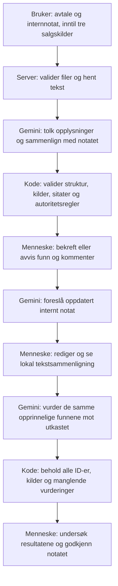

# Teknisk guide – fra salgskilder til kontrollert overlevering

Handover AI er ett avgrenset arbeidsløp: last opp → analyser → vurder funn → generer forslag → kontroller på nytt → godkjenn manuelt. Formålet er å undersøke om relevant informasjon fra salgsfasen kommer med til leveringsteamet. Mindre omarbeid og bedre overlevering er hypoteser, ikke målte gevinster.

## Hvorfor flere dokumenter?

Avtalen beskriver det som er avtalt, mens tilbud, korrespondanse og møtenotater kan forklare forventninger, salgsløfter og praktiske behov. Å bruke bare avtalen kan overse viktig kontekst. Å behandle alle kilder som like autoritative kan derimot gjøre et uavklart ønske om til et løfte.

Derfor kreves én signert kundeavtale og ett internt overleveringsnotat. Tre faste, valgfrie plasser dekker tilbud, kundekorrespondanse og møtenotater. Det er én fil per plass, uten integrasjoner eller nye roller. «Signert» beskriver dokumentets tiltenkte rolle; prototypen verifiserer ikke digitale signaturer.

## Arkitektur og ansvarsdeling

**AI tolker mening.** Den identifiserer relevante opplysninger, sammenligner omskrivinger og vurderer konflikter, usikkerhet og behov for bekreftelse.

**Kode kontrollerer det målbare.** Zod validerer dataformat og grenser. Koden finner sitatene i riktig fil, beregner verifikasjonsstatus, håndhever konservative autoritetsregler og sikrer at ingen opprinnelige funn forsvinner fra ny kontroll.

**Mennesket tar beslutningen.** Bekreftet betyr enighet i funnet, ikke at problemet er løst eller at avtalen er endret. Godkjenning gjelder bare det interne notatet. Ingen av kontrollene garanterer riktig tolkning eller juridisk etterlevelse.

## Dokumenter og datamodell

Hver fil har en fast `id`, en eksplisitt `documentType`, filnavn, filtype PDF/TXT, byteantall og uttrukket tekst. ID og dokumenttype må stemme med dokumentplassen. Erstatning av en fil beholder plassen, men nullstiller tidligere analyse og vurderinger.

| ID og dokumenttype | Betydning                                         |
| ------------------ | ------------------------------------------------- |
| `agreement`        | Obligatorisk signert kundeavtale og primærkilde   |
| `handover`         | Obligatorisk internnotat som kontrolleres         |
| `proposal`         | Valgfritt tilbud eller salgsforslag               |
| `correspondence`   | Valgfri kundekorrespondanse                       |
| `meeting_notes`    | Valgfrie møtenotater eller annen salgsinformasjon |

Dokumentobjektet har to obligatoriske og tre valgfrie felt. Ukjente plasser avvises. Tomme valgfrie plasser sendes ikke til Gemini. Dette gir stabile kildehenvisninger uten database, dynamisk dokumentregister eller kompleks versjonering.

Et AI-funn har tittel, beskrivelse, kategori, klassifisering, forklaring og sikkerhet i ordlyden. `sourceDocumentId` og `sourceQuote` angir primærkilden; `relatedSources` kan ha inntil tre andre dokument/sitat-par. `handoverQuote` viser relevant tekst fra notatet, eller er null. Kildesitater har maksimalt 1 500 tegn.

`informationType` skiller mellom `contractual`, `follow_up` og `conflict`. `requiresConfirmation` uttrykker modellens vurdering av behov for bekreftelse. Koden legger til funn-ID, verifiseringsstatus og effektiv klassifisering. Menneskelig beslutning og kommentar holdes separat. Gamle nettleserresultater gjenopprettes ikke automatisk; det gamle todokumentskjemaet migreres ikke i bakgrunnen.

## Kildehierarki og klassifisering

Signert avtale er førende for avtaleforpliktelser. Støttekilder kan gi relevante opplysninger, men blir aldri automatisk endringer av avtalen. Gemini instrueres om å gå gjennom hver støttekilde og ta med relevant informasjon som ikke allerede dekkes av et annet funn.

- **Dekket:** Relevant innhold er tilstrekkelig overført med samme mening.
- **Potensielt manglende:** Tilsvarende informasjon ble ikke funnet i notatet.
- **Må avklares:** Konflikt, usikker ordlyd, utilstrekkelig kildebelegg eller behov for bekreftelse.

Autoritet og dekning er forskjellige ting. Et praktisk ønske kan være korrekt overført og fortsatt være salgsinformasjon. En motstridende kundeforventning må avklares selv om den står ordrett i notatet.

Koden tillater ikke at et funn med støttedokument som primærkilde beholder `contractual`. Slike påstander blir oppfølgingsinformasjon som krever bekreftelse. Tvetydige eller bekreftelseskrevende påstander presenteres heller ikke som sikre avtaleforpliktelser. I første analyse gir `conflict` og `requiresConfirmation=true` «Må avklares». Dette er konservative presentasjonsregler; kode avgjør ikke semantisk om to ulike tekster faktisk er i konflikt.

## Gemini-integrasjon og duplikater

Alle kall skjer på serveren gjennom offisiell `@google/genai`, Generate Content og strukturert JSON med `responseSchema`. Det brukes ingen agenter, verktøykall eller eksterne oppslag. Dokumenttekst og kommentarer er ubetrodd data, adskilt fra systeminstruksen. API-nøkkelen leses fra servermiljøet og skal ligge lokalt i `.env.local`.

Modell og kode er eksplisitt konfigurert: standarden er `gemini-3.8-flash`, mens dokumenterte tester bruker det lokalt valgte `gemini-3.5-flash-lite`. Ingen automatisk modellbytting, fakturering, retry eller erstatning med demodata utføres. Hvert kall har 60 sekunders tidsgrense og konkrete feil for ugyldige svar, tilgang, kvote og timeout.

Gemini skal samle samme opplysning fra flere kilder i ett funn og legge de andre kildene i tilleggssitatene. En konflikt skal vise begge sider i samme funn. Koden slår i tillegg sammen identiske normaliserte primærsitater og beskrivelser innen samme kategori, foretrekker avtalen som primærkilde når den er representert, og beholder de øvrige sitatene. Speilvendte konflikter fra ulike primærkilder samles også når kategori og hele settet av kildeutdrag er identisk og avtalen er med. Titler og nøkkelord brukes ikke som grunnlag for sammenslåing. Tvetydige treff beholdes separat. Motstridende klassifiseringer eller usikkerhet gir avklaring. Den enkle regelen erstatter ikke semantisk duplikatkontroll; ulike formuleringer kan fortsatt gi gjentatte eller ufullstendige funn. Korte, avgrensede sitater er viktige.

SDK-skjemaet utledes fra Zod. Enkelte lengde- og antallsfelter utelates fra leverandørskjemaet fordi tidligere live-testing avdekket avviste forespørsler. Alle grensene håndheves fortsatt lokalt med Zod. Et strukturert svar er ikke nødvendigvis faglig riktig.

## Deterministisk kildekontroll

Hvert primær- og tilleggssitat kontrolleres bare mot dokumentet med den angitte ID-en. Et sitat som finnes i avtalen, men er tilskrevet e-posten, blir ikke godkjent ved å søke i alle filene. En henvisning til en ikke-opplastet kilde avviser resultatet.

Sammenligningen bruker Unicode NFC og normaliserer mellomrom og linjeskift. Ord, tall, store/små bokstaver og negasjoner endres ikke. Et manglende eller omskrevet sitat blir uverifisert. Uverifisert primærkilde, tilleggskilde eller handoversitat gir «Må avklares». Kilde-ID og filnavn vises i funnet; ingen sidetall oppfinnes.

`modelClassification` bevarer modellens forslag etter eventuell duplikatsamling; `classification` er resultatet etter konservativ validering. Et fraværende handoversitat er `not_provided`, ikke et verifisert bevis på utelatelse. Et korrekt kildeutdrag kan fortsatt være irrelevant for modellens forklaring.

## Forslag og faktisk tekstsammenligning

Forslag kan genereres etter at alle potensielt manglende funn og funn som må avklares er bekreftet eller avvist. Dekkede krav krever ikke vurdering og telles ikke som uavklarte i fremdriften. Valgfrie vurderinger og kommentarer beholdes, uten automatisk menneskelig bekreftelse. Både klient og server bruker samme regel. Alle krav, inkludert dekkede, beholdes i grunnlaget for ny analyse. Serveren mottar originaldokumentene, funnene, beslutningene og kommentarene, og beregner kildeverifiseringen på nytt. Endringslisten får bare vise til kjente, bekreftede funn.

Gemini skal bevare korrekt innhold og bruke bekreftede, eksplisitte avtaleopplysninger til rettelser. Oppfølgingsinformasjon og konflikter skal beskrives som spørsmål eller uavklarte forhold med kilde-ID, ikke nye avtalte leveranser. Avviste funn skal ikke gi automatiske rettelser. Kommentarer er kontekst, ikke dokumenterte avtaleendringer. Koden kan ikke bevise at hele utkastet følger instruksen; det må leses av brukeren.

Redigeringsfeltet beholdes. **Se faktiske tekstendringer** sammenligner originalnotatet med gjeldende redigert tekst, uavhengig av AI-ens oppsummering. Lokal linjesammenligning viser tillegg grønt, slettinger rødt og uendret tekst nøytralt. En begrenset tabell for lengste felles linjefølge holder minnebruken nede; svært store linjeantall gir en grovere erstatningsvisning. CRLF og LF behandles likt. Ingen ny avhengighet er lagt til.

## Fast grunnlag ved ny kontroll

`/api/reanalyze` mottar den opprinnelige analysen og det redigerte notatet. Alle originale kilder beholdes, mens bare `handover` erstattes. Gemini får listen med faste funn-ID-er, kildehenvisninger, opplysningstype og bekreftelsesbehov. Den skal returnere én vurdering per ID og får ikke trekke ut et nytt sett med krav.

Koden setter sammen resultatet fra originalfunnene. ID, primær- og tilleggssitater, dokument-ID-er, kategori og autoritet beholdes; bare dekning, forklaring og sitat fra det nye notatet vurderes på nytt. Sitatkontroll og autoritetsregler kjøres igjen. Første klassifisering vises ved siden av den nye.

Ny kontroll skiller dekning fra videre oppfølging. Gemini må eksplisitt oppgi `followUpDocumented=true` og `covered` når en åpen sak er tydelig overført som oppfølging, med begge sider av en konflikt og uten nye løfter. Koden krever i tillegg ett entydig svar og verifiserte kilde- og notatsitater. Da kan dekningen være «Overført – krever oppfølging», mens opprinnelig autoritet og bekreftelsesbehov beholdes uendret. Manglende eller falske sitater, eller et vanlig `covered`-svar uten eksplisitt vurdering av oppfølgingen, beholder avklaringsstatus. Koden verifiserer tekstforekomst; AI vurderer fortsatt meningen. Demoen gjenkjenner bare hele den kjente oppfølgingsformuleringen. Åpne saker telles separat fra mulige mangler i notatet, og manuell godkjenning gjelder fortsatt bare notatet.

Manglende eller dupliserte vurderinger beholdes som «Må avklares» med `not_evaluated`. Et tomt svar gir ett slikt punkt per opprinnelig funn. Godkjenning sperres til alle ID-er er vurdert. En ny forespørsel kan fullføre kontrollen. Ukjente svar-ID-er avvises. Endring av tekst eller vurderinger gjør tidligere kontroll og godkjenning ugyldig.

Fast grunnlag beskytter bare funn som faktisk ble identifisert første gang. Det kan ikke rette opp førstegangsutelatelser eller garantere at nye udokumenterte løfter i utkastet oppdages. Fagpersonen må derfor lese både kildene og selve tekstendringene.

## Grenser uten skjult avkorting

Filgrensene er uendret: 2 MiB, inntil 40 PDF-sider og 20–20 000 uttrukne tegn per fil. Skannede eller teksttomme sider avvises konservativt. Ingen OCR eller innboksintegrasjon er implementert.

Alle dokumentplassene deler nå **40 000 tegn samlet**. Det er samme maksimale tekstbudsjett som den opprinnelige avtale/notat-løsningen, fordelt på flere kilder for å begrense kvotebruk og behandlingstid. Kilder fjernes eller forkortes av brukeren; teksten avkortes aldri automatisk. Samme grense gjelder når et utkast erstatter notatet, og forslagskallet får vite hvor mange tegn som er tilgjengelige.

JSON-grensene beholdes: 260 000 byte for første analyse, 512 000 for forslag og ny kontroll. Filopplasting bruker 2 MiB pluss begrenset multipart-overhead. Kroppen leses med faktisk bytegrense, også uten `Content-Length`. Store serialiserte resultater kan derfor avvises selv om enkelte felt er innenfor sine egne grenser. Maksimalt 40 funn og tre tilleggssitater per funn beholdes uten stille avkorting.

Analyse, forslag og ny kontroll deler fem AI-kall per ti minutter og én samtidig forespørsel per serverprosess. Strupingen er lokal og nullstilles ved restart. Origin-kontroll, inputvalidering og struping er ikke tilstrekkelig produksjonssikring for en offentlig tjeneste.

## Demo, testing og historiske resultater

Den nåværende demoen har avtale, internnotat og fiktiv kunde-e-post. Åtte forhåndsvaliderte funn inkluderer ett ERP-punkt med to kilder, et nytt Teams-ønske og en konflikt om historiske fakturaer. Demoen genererer et merket regelbasert forslag med åpne spørsmål. Ny kontroll gjenkjenner bare kjente formuleringer, beholder alle åtte funn og bruker ingen API-kall. Den er ikke en generell semantisk analyse av frie redigeringer.

Regresjonstestene beholder egne todokumenteksempler og dekker i tillegg valgfrie plasser, dokumenttype, samlet tekstbudsjett, kilde-ID, alle sitater, autoritet, eksakte duplikater, konflikter, forslagsgrunnlag og tom/ufullstendig ny kontroll. Gemini-SDK-et mockes i automatiske tester. Ekte lokal PDF-uttrekking testes separat. Faktisk kjørte kontroller og eventuelle live-begrensninger står i [verifiseringsloggen](verification.md).

[Rapporten fra 20. oktober 2026](evaluation-gemini-3.5-flash-lite-2026-10-20.json) og de ti historiske dokumentparene gjelder kun todokumentversjonen. Tallene 4 identifiserte utelatelser, 0 oversette, 0 falske positive og 71,4 % streng matching er ikke en evaluering av nye støttekilder. Rapporten er uendret; dagens kode bruker generiske kildefelt og kan gi andre resultater ved ny kjøring. Den opprinnelige matcheren krevde kategori og overlappende avtaleanker, og kategoriforskjeller påvirket poengsummen.

## Hva prototypen ikke beviser

PDF-leserekkefølge kan være feil, modellen kan overse eller misforstå opplysninger, og prompt injection kan ikke elimineres med en systeminstruks alene. Opplysninger som står i et dokument, er heller ikke nødvendigvis sanne eller bekreftede. Bruk bare syntetisk, ikke-konfidensielt materiale.

Appen lagrer ikke dokumenter permanent på serveren. Review beholdes lokalt under aktiv kontroll; en ny sideåpning starter tomt. Utkast og godkjenning ligger bare i minnet. Googles behandling av live-tekst følger tjenestevilkår og prosjektinnstillinger.

For å undersøke reell nytte trengs flere uavhengig merkede flerdokumenttilfeller og en sammenligning av manuell og AI-støttet gjennomgang med prosjektledere. Flere integrasjoner eller en database er ikke nødvendig for å teste denne hypotesen.
